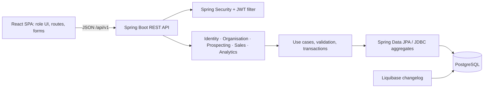

# Prosperr Sales CRM — Interview Guide

Use this as the project’s concise technical walkthrough. It describes the code and the product rules currently implemented; see [Open Questions](OPEN-QUESTIONS.md) for decisions that are still provisional and the [ADRs](adr/) for detailed rationale.

## 1. Project pitch

**30-second answer:** Prosperr Sales CRM is a role-based CRM that connects company discovery, contact management, BDR outreach, SQL review, Sales Manager assignment, AE opportunity progression, and Leadership analytics. It is a separate React application backed by a Java/Spring Boot modular monolith and PostgreSQL. The backend owns authorization, workflow rules, transactions, and persistence; Liquibase manages database changes.

**What problem does it solve?** It preserves context as a prospect moves between people and stages. A contact is a person, a lead is a BDR-owned sales pursuit, an SQL is its qualification/review record, and an opportunity is the approved pursuit assigned to an AE. Those are separate concepts with separate histories.

## 2. Business workflow and roles

```text
BDR discovers organisation + contacts
  → creates a lead and logs calls/follow-ups
  → submits an SQL qualification
Sales Manager reviews and approves/rejects
  → assigns an approved SQL to an active AE
AE manages stakeholders and meetings through L1 → L2 → L3
  → closes Won or Lost; Won creates an implementation handover
Leadership reviews organisation-wide performance, funnel, and revenue
```

| Role | Main responsibility | Data boundary |
|---|---|---|
| ADMIN | Create/manage users, roles, account status, and temporary passwords | Identity administration; this does not imply unrestricted ownership of each workflow |
| BDR | Discover organisations, add contacts, own leads, log calls/follow-ups, submit SQLs | Own leads and qualifications; shared organisation/contact directory |
| SALES_MANAGER | Review BDR SQLs; assign/reassign opportunities; monitor performance; decide AE reopen requests | Organization-wide BDR/AE scope, independent of optional manager links |
| AE | Work assigned opportunities, meetings, stakeholders, stages, close, handover | Current assignments only |
| LEADERSHIP | Read organization-wide analytics | Analytics APIs are role-protected and read-only |

Organisations and contacts are shared directory records. Leads are not contacts. One qualification is associated with one lead; an approved qualification can create at most one opportunity. Assignment, qualification review, stage changes, closures, and reopen decisions retain history.

See the [pictorial user-flow diagram](USER-FLOW.md) for the role handoffs and lifecycle at a glance.

## 3. System design



- **Frontend:** `frontend/` is a React SPA. Routes and role navigation, shared shell/components, feature pages, and a shared Axios API client are kept in separate areas.
- **Backend:** `backend/` is one deployable Spring Boot modular monolith. Packages group code by capability: `identity`, `organisation`, `prospecting`, `sales`, and `analytics`.
- **Typical request:** controller validates/maps HTTP input → service applies business and authorization rules in a transaction → repository queries JPA/PostgreSQL → service maps a response DTO.
- **Analytics:** `LeadershipAnalyticsService` uses named-parameter SQL aggregates for read-heavy reporting rather than loading full entity graphs.
- **Schema:** Liquibase changesets 001–006 create/evolve the schema. Hibernate schema auto-update is disabled.
- **Why a modular monolith?** One team can build and run a single transactionally consistent product without service discovery, distributed transactions, deployment coordination, or duplicated security. Package boundaries preserve future seams. Split services only if deployment/scaling/team constraints demonstrate a need.

## 4. Technology choices and trade-offs

| Choice | Why it fits this CRM | Trade-off / boundary |
|---|---|---|
| Java 21 + Spring Boot 3.5 | Strong typing, mature validation/security/data support, familiar Java team | More framework conventions and configuration than a small scripting API; company-approved versions take priority |
| Spring MVC + REST/JSON | Clear API boundary for a separate React SPA; resource-oriented HTTP methods | Requires API versioning and DTO maintenance; not real-time by itself |
| Spring Security + JWT | Role-protected stateless API; active user is reloaded on each request | Token revocation/refresh and issuer/audience policy need additional design for production federation |
| Spring Data JPA | Product records are relational; entities/transactions and standard repositories fit CRUD/workflows | Complex reporting can be awkward in ORM, so analytics uses explicit SQL; avoid lazy-loading/N+1 surprises |
| PostgreSQL | Relationships, foreign keys, transactions, unique indexes, expression/partial indexes, and SQL aggregates match the data and rules | Requires managed database operations, migration discipline, backups, and query/index tuning |
| Liquibase | Versioned, reviewable schema history; applies migrations consistently from an empty or prior schema | Changesets are append-only operational artifacts and must be tested on the target PostgreSQL version |
| React + Vite | Component-based SPA with fast local development; React Router provides role-aware views | Client-side checks are UX only; backend still authorizes every protected API |
| Tailwind CSS + local UI components | Shared visual system with quick responsive composition | Utility-heavy markup needs shared components and tokens to avoid inconsistent one-off styles |
| Axios + Recharts + Lucide | Shared HTTP configuration, charts, and icons | Chart bundle increases frontend size; split/lazy-load if measured load performance warrants it |

### Why PostgreSQL instead of a document database?

The core data is relational: users own leads, leads link to organisations and contacts, qualifications link to leads, and opportunities link to qualifications and AEs. Foreign keys and transactions protect handoffs. PostgreSQL also supports the project’s case/whitespace-normalized unique indexes and filtered contact-email uniqueness. That makes integrity enforceable in the database during concurrent requests, not only through an application pre-check.

MongoDB can model documents well, but these relationships and multi-record workflow updates would require more application-managed consistency and denormalized reporting. SQLite is convenient for embedded/local use but is not the chosen shared server database. MySQL is a capable relational alternative; the choice here is PostgreSQL because its constraints, indexes, and SQL reporting fit this CRM, not because one database is universally best.

## 5. API design

- Base path is `/api/v1`; controllers expose resources and workflow actions using `GET`, `POST`, `PUT`, `PATCH`, and `DELETE` where appropriate.
- Request/response DTOs isolate the public contract from JPA entities. Validation uses Jakarta Validation; centralized exception handling maps errors to HTTP responses.
- List APIs use zero-based `page`, bounded `size` (normally up to 100), filters, and Spring page responses. Server-side filtering/pagination prevents loading unbounded business lists.
- Role and record ownership checks happen in Spring Security and service methods. React route guards only hide/redirect UI.
- OpenAPI/Swagger is available for local API exploration.

| API group | Representative routes | Purpose |
|---|---|---|
| Auth | `POST /auth/login`, `GET /auth/me`, `POST /auth/change-password` | Sign-in, current identity, forced password change |
| Admin | `/admin/users`, `/admin/dashboard` | User administration and identity overview |
| Shared directory | `/organisations`, `/contacts` | Search shared organisations/contacts; BDR/Admin mutations |
| BDR | `/bdr/leads`, `/bdr/leads/{id}/calls`, `/bdr/follow-ups`, `/bdr/sql-qualifications` | Owned pursuits, append-only call activity, follow-ups, SQL drafts/submission |
| Sales Manager | `/sales-manager/sql-qualifications`, `/sales-manager/.../assign`, `/sales-manager/opportunities` | Review, assignment/reassignment, history, team metrics, reopen decisions |
| AE | `/ae/opportunities`, `/ae/opportunities/{id}/stage`, `/close-won`, `/close-lost`, `/meetings` | Current assignments and opportunity lifecycle |
| Leadership | `/leadership/analytics/{overview,bdrs,sales-managers,aes,funnel,revenue}` | Filtered aggregate reporting |

The full concise route list and access roles are in [API Reference](api-documentation.md).

## 6. Database model and integrity

The schema uses UUID primary keys, foreign keys, status columns backed by Java enums, timestamps, and indexes chosen for lookup/filter paths. The core table groups are:

| Area | Tables | Important relationship / rule |
|---|---|---|
| Identity | `app_user`, `app_role` | Each user has one role; email is unique after case normalization; account has active and forced-password-change flags |
| Directory | `organisation`, `contact` | One organisation has many contacts; organisation name unique after trim/case-fold; contact email unique per organisation when nonblank |
| Prospecting | `sales_lead`, `call_activity`, `follow_up` | Lead is linked to an organisation and primary contact and owned by a BDR; calls are append-only; follow-up completion points to a new call |
| Qualification | `sql_qualification`, `sql_qualification_history`, legacy `sql_submission` | One qualification per lead; history captures actor, decision/reason, and snapshot |
| Assignment | `sales_opportunity`, `opportunity_assignment_history`, `app_notification` | One opportunity per qualification; assignment changes create history; notification is recipient-owned |
| AE lifecycle | `opportunity_stage_history`, `opportunity_meeting`, `opportunity_meeting_participant`, `opportunity_stakeholder`, `opportunity_closure`, `implementation_handover`, `opportunity_reopen_request` | Multiple audit/activity rows per opportunity; a handover is created per Won close; each contact can appear once per opportunity |

### Constraints and transaction boundaries

- Unique indexes enforce normalized email/organisation/contact keys. A service-level `exists` check gives a friendly error; the database index is the final race-safe guard.
- Foreign keys prevent orphaned records. A stakeholder/meeting participant must belong to the opportunity’s organisation, checked in the service.
- Multi-row actions (SQL approval, opportunity assignment/history/notification, meeting/stage transition, closure/handover) are transactional so either the business action and its audit records commit together or none do.
- `@Version` optimistic locking is used on frequently edited organisation, contact, lead, qualification, and opportunity entities to detect stale concurrent edits.
- No custom sharding/cache is implemented; add only when traffic and measurements require it.

See [ER Diagram](er-diagram.md) for the relationship sketch and [Database Notes](database-design.md) for constraints/migration details.

## 7. Security and correctness

- JWT access tokens are signed with HS256 using an environment-provided secret; they expire after 15 minutes. The frontend keeps the access token in memory; no refresh-token flow is implemented.
- Passwords use BCrypt. APIs return no password or hash. First admin is environment-bootstrapped; admin-issued temporary passwords must be changed at next sign-in.
- JWT filter reloads the user and rejects inactive accounts, so deactivation affects existing tokens on the next request.
- Endpoint roles are enforced by Spring Security; ownership checks are repeated in services for record-specific operations.
- Input constraints, service rules, foreign keys, unique indexes, `@Version`, and transactions defend different failure modes; none substitutes for all the others.
- CORS is configured by allowed origin. Secrets are environment configuration, not committed files.

**Discuss production hardening honestly:** issuer/audience validation, refresh/session strategy, rate limiting, audit retention, structured security monitoring, production CORS/secret rotation, backup/restore, and PostgreSQL-specific CI need a deployment threat/operations review. Do not claim they are already solved by JWT or local tests.

## 8. Design principles and patterns in this project

| Principle/pattern | Actual example | Why this level is appropriate |
|---|---|---|
| SRP / separation of concerns | Controller → feature service → repository; React routes/pages/shared components | Each layer owns HTTP, rules, persistence, or presentation |
| Encapsulation | `OpportunityEntity.advanceStage/closeWon/closeLost/reopen`; `UserEntity` password methods | State changes keep related invariants together |
| DIP / dependency injection | Constructor-injected services and Spring repositories | Dependencies visible and replaceable; no service locator |
| DRY | Shared Axios/auth context, common UI components, normalized repository/service rules | Reuse stable repeated behavior, not every line of similar markup |
| KISS / composition over inheritance | One role foreign key; React shell composed from sidebar/top bar/pages | Avoid speculative role subclasses and generic frameworks |
| MVC / REST | API controllers map requests to DTOs and feature services | Familiar transport boundary; keep controllers thin |
| Repository + Service Layer | Spring Data repositories and transactional services | Query ownership and business policy are testable separately |
| DTO | Explicit input/output records | Prevent entity coupling and secret leakage |
| Framework Chain of Responsibility | `JwtAuthenticationFilter` participates in Spring Security filter chain | Reuse the framework pipeline for HTTP authentication |
| Enum-driven lifecycle (not State-pattern classes) | `OpportunityStatus` + explicit transition checks | Five known stages have simple rules; one class per state would add indirection |
| Append-only history | Qualification, assignment, stage, and closure events | Preserve who did what and when across edits/reopen |
| Read-model aggregate queries | `LeadershipAnalyticsService` separate SQL aggregates | Efficient dashboards; separate joins avoid inflated counts |

Factory, Adapter, custom Decorator/Facade, Strategy, domain Observer/Event Bus, Template Method, and custom State classes are **not** currently implemented. For example, Strategy becomes useful only if qualification or assignment rules have genuinely interchangeable policies; an Adapter becomes useful once a real external provider is chosen. See [Patterns](DESIGN-PATTERNS.md) and the [ADR index](ARCHITECTURE-DECISIONS.md).

## 9. Data structures and algorithms: what is actually used

This CRM is mostly an information and workflow system; it does not need a novel algorithm. Explain how standard structures and database operations solve the real problems:

- **Enums** represent the fixed role, call outcome, SQL state, opportunity stage, meeting level, and stakeholder role sets. The stage rank check is constant time, O(1), and rejects backward moves; skip requires a reason and close is only allowed from L3.
- **Lists** hold bounded page results and ordered histories. **Maps** group page contact counts and collect manager assignment durations by UUID when composing analytics DTOs. Sets/distinct IDs prevent duplicate participants.
- **B-tree indexes and SQL** handle normalized uniqueness, search predicates, pagination, count/sum/group-by reporting. Do not fetch all rows and hand-sort when the database can filter/page them.
- **Database uniqueness** solves concurrent duplicate writes. Checking with `existsBy...` alone is not race-safe: two requests can both pass before either inserts.
- **Separate aggregate queries** prevent join fan-out. If one organisation has five contacts, counting organisations in the same raw join can count it five times; the analytics service counts the two domains independently.
- **Possible future structure:** if stage transitions become a non-linear configurable graph, model an explicit transition map (e.g. `EnumMap<Stage, Set<Stage>>`) and test every allowed/denied edge. Current linear rules do not need it.

## 10. KPI definitions and known trade-offs

- Leadership revenue uses the final deal value for currently Won opportunities and displays INR pending official currency confirmation.
- Leadership SQL conversion is approved SQLs ÷ submitted SQLs.
- Leadership assignment time is average approval-to-first-assignment duration.
- Organisation and contact counts are independent counts to avoid join duplication.
- AE conversion is won ÷ (won + lost). An opportunity-stage filter applies to stage-based metrics; date filters use Asia/Kolkata day boundaries.
- Revival/expired-customer analytics are not configured: Block 7’s customer lifecycle is not modeled.
- Leadership analytics use live database queries rather than materialized views. This is simpler and keeps values fresh for the current volume; if measured latency or scale demands it, consider indexes, query plans, caching, or materialized read models.
- The product currency and full SQL acceptance rubric remain open. INR is a current display/default assumption, not a confirmed company policy.

## 11. Testing and verification

- Backend: Spring Boot integration tests cover identity, organisation/contact, prospecting/qualification, manager assignment, AE lifecycle, Leadership aggregates, and role/ownership denials. Tests use H2 in PostgreSQL compatibility mode.
- Frontend: Vitest + React Testing Library cover auth/role routing and selected UI flows; Vite production build checks bundling/compilation.
- Liquibase changesets run in the integration context; local PostgreSQL startup has previously exercised schema setup, but **H2 compatibility is not a replacement for PostgreSQL CI**.
- Useful additional checks before production: run all migrations and core queries on the exact PostgreSQL version, API security tests by role, accessibility checks, query-plan/performance checks, and restore/backup rehearsal.

## 12. Interview questions to practice

**Why a modular monolith instead of microservices?** The workflow and team are still cohesive and small. One deployable app keeps transactions, local development, and operations simple; package boundaries give room to split later based on real scaling or team ownership needs.

**Why PostgreSQL?** The data has strong relationships and integrity rules. PostgreSQL provides transactions, foreign keys, expression/partial unique indexes, and SQL aggregates that directly support them. A document store is possible, but would move more consistency and relationship work into application code.

**Why both DTOs and entities?** Entities model persistence and relationships; DTOs define the API contract. This prevents leaking password hashes/lazy JPA state and lets either layer evolve independently.

**How do you prevent duplicate organisations under concurrent requests?** Normalize/trim before friendly pre-check, then rely on the database unique functional index as the definitive guard; map a constraint conflict to a client-safe response.

**How do you prevent an AE from accessing another AE’s opportunity?** Spring Security requires AE role, and service queries load the opportunity by both ID and authenticated AE ID. A guessed UUID alone does not grant access.

**How is history preserved?** Current state is stored on the aggregate for efficient reads, and important transitions append separate actor/time/reason snapshots. Reopen does not erase earlier closure history.

**Why not a State or Strategy pattern?** The current lifecycle is fixed and simple, so enum plus explicit validation is clearer. Reconsider when state-specific behavior or multiple active policies create real branching complexity.

**What is the role of PostgreSQL indexes?** They support uniqueness and common filters/lookups. Indexes cost disk and write time, so choose them from query patterns, then verify with `EXPLAIN` and production-like data instead of indexing every field.

**What are the main trade-offs/next improvements?** Confirm production identity/session and currency policies; add PostgreSQL-backed CI and observability; consider pagination for admin users; review deny-by-default behavior and token issuer/audience; define revival and targets; measure analytics query performance before adding cache/materialized views.

**How did you use AI?** Explain your real workflow: use AI for scaffolding, explanations, and review assistance, then read the implementation, check it against requirements, run tests/builds, inspect failures, and keep secrets/private customer data out of prompts. Be transparent and be able to explain every shipped design choice yourself.

## 13. Honest project boundaries

Implemented: Blocks 0–6 and 8. Not implemented: Block 7 revival, target management, production deployment/operations, calendar/telephony/email integrations, and a production refresh-token/session design. Local baseline versions are Java 21, Spring Boot 3.5.16, Node.js 24 LTS, React 19, Vite 7, PostgreSQL 18 local, and Liquibase. Confirm the company’s supported production versions before deployment.
