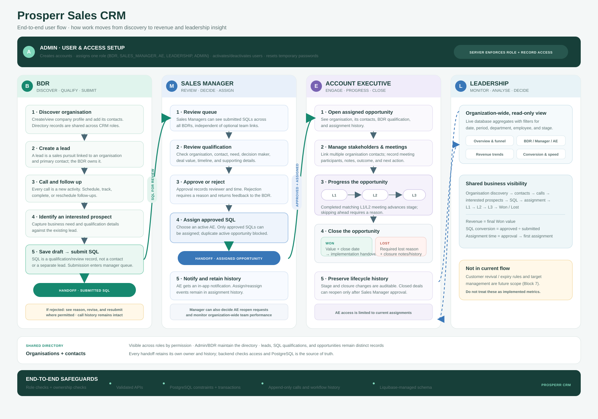

# Prosperr CRM user flow

This diagram shows how work moves through the implemented CRM: Admin account setup, BDR discovery and qualification, Sales Manager review and assignment, AE opportunity progression, and Leadership analytics. Organisations and contacts are shared directory records; leads, SQL qualifications, and opportunities have separate responsibilities and histories.

**Scope note:** Customer revival/expiry and target management are future scope (Block 7), not part of the current live flow. Access is enforced by the backend, and the image’s flow reflects the current implementation documented in the [Interview Guide](INTERVIEW-GUIDE.md).
