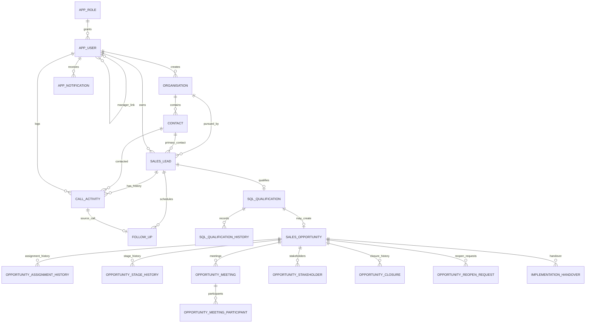

# Entity relationship overview

This diagram covers the implemented persistence model. `sql_submission` is a legacy table from the initial submission flow. Targets and customer revival are not currently modeled.

## Key cardinalities and rules

- One account has one role. `app_user.manager_id` is an optional reporting link; it does not limit Sales Manager team-wide access.
- One organisation has many contacts and sales leads. A lead links one organisation, one primary contact, and its BDR owner.
- One lead has at most one SQL qualification; an approved qualification can create at most one opportunity.
- Calls, SQL reviews, assignments, stage changes, closures, and reopen decisions retain separate history records.
- Stakeholders and meeting participants link contacts to opportunities/meetings; the service verifies they belong to the same organisation.
- A Won closure creates an implementation handover record.

For physical columns, indexes, foreign keys, and changeset ownership, see [Database Notes](database-design.md) and `backend/src/main/resources/db/changelog/db.changelog-master.yaml`.
