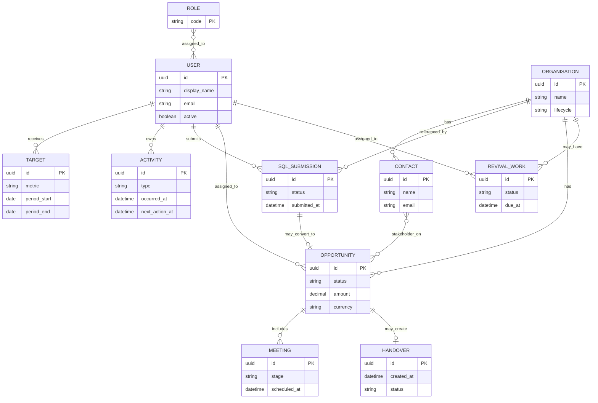

# Provisional ER Diagram

**Conceptual only.** This is a discussion aid, not a database schema. Dashed relationships and entity names are candidates. Cardinalities and lifecycle must be confirmed before migrations are designed.

## Important caveats

- The SQL submission → opportunity conversion may be one-to-one, one-to-many, or not a separate record at all.
- A contact may belong to multiple organisations; an activity may relate to several record types. These are unresolved.
- Role assignment may be single-role, multi-role, or scoped by team. The drawing does not settle that question.
- `lifecycle`, `status`, `stage`, `metric`, and `type` values are placeholders, not approved enums.
- Use database-native UUIDs and types only after the agreed Java/PostgreSQL versions and conventions are chosen.
