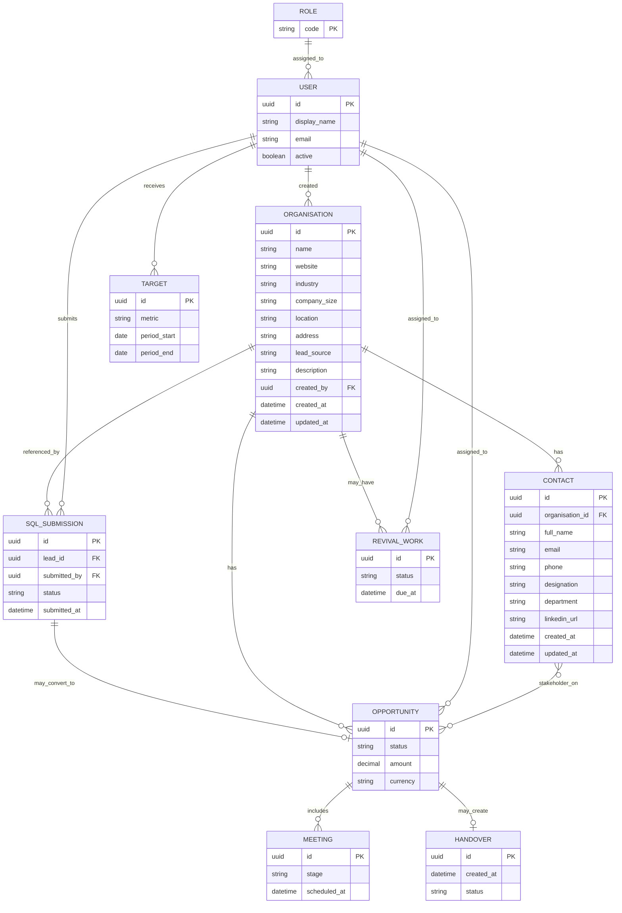

# ER Diagram

Identity, organisation, and contact tables are implemented through Liquibase. Later CRM workflow entities remain conceptual.

## Implemented relationship and duplicate rules

- One `app_user` created-by reference can be associated with many organisations; each organisation retains one creator.
- One organisation has zero or more contacts; each contact belongs to exactly one organisation. The database foreign key prevents deleting an organisation while it still has contacts; no delete endpoint is exposed in this block.
- Organisation name uniqueness is case-insensitive after trimming. The database index enforces this against concurrent requests.
- Contact email is optional and unique within one organisation when supplied, case-insensitive after trimming. A person may be linked to another organisation with the same email.
- A contact is a person record. It is not an SQL, lead, or opportunity.

## Important caveats

- The SQL submission → opportunity conversion may be one-to-one, one-to-many, or not a separate record at all.
- A contact belongs to one organisation in Block 3. Revisit only if the business requires a person-to-many-organisations relationship; activity relationships remain unresolved.
- Role assignment is one role per user in the implemented identity module.
- `lifecycle`, `status`, `stage`, `metric`, and `type` values are placeholders, not approved enums.
- Use database-native UUIDs and types only after the agreed Java/PostgreSQL versions and conventions are chosen.
