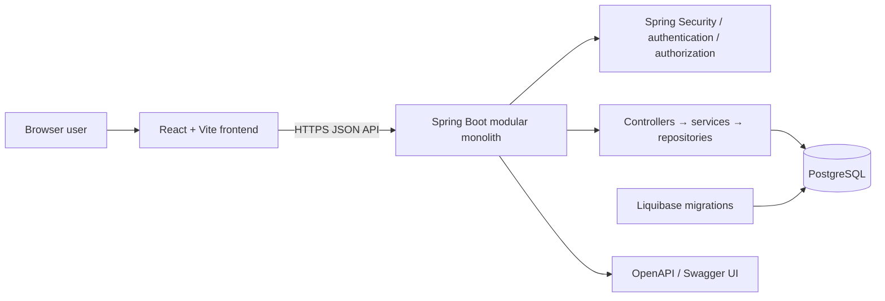

# System Architecture

**Status: Proposed; confirm deployment, identity, and integration constraints before implementation.**

## Proposed shape

## Boundaries

- `frontend/` owns presentation, navigation, client-side validation for usability, and API calls. It is not an authorization boundary.
- `backend/` owns authentication, authorization, validation, business rules, transactions, and persistence. Each API must enforce role and record-level access server-side.
- PostgreSQL is the durable source of business records. Liquibase is the controlled schema-change mechanism.
- The backend is one deployable modular monolith with clear internal modules. Module boundaries should follow confirmed business capabilities rather than speculative microservices.

## Proposed backend layers

`controller → service → repository → database`, with request/response DTOs, domain entities kept internal, centralized exception mapping, Jakarta Validation, and transaction boundaries in services.

## Authentication and authorization

The brief requests JWT and BCrypt. Token issuance, storage, expiry, refresh/revocation, identity provider, password reset, account provisioning, and initial administrator setup are undecided. JWT in browser storage has security tradeoffs; choose token transport only after the threat model and deployment origin are known. Enforce role and ownership checks on the backend regardless of frontend navigation.

## Proposed modules (not final)

Identity/access, users/targets, organisations/contacts, qualification/review, opportunities/meetings, outcomes/handover, revival, and reporting. Some may combine or split after workflow clarification.

## Operational decisions still open

Java/Spring Boot and Node/package-manager versions; PostgreSQL hosting/version; Liquibase bootstrap strategy; development and production environments; CORS/origins; secrets management; logging/audit; backup/restore; observability; and deployment platform. No environment-specific values or secrets are committed.

## Architecture principles

- Keep transport, business logic, and persistence responsibilities separate.
- Use explicit DTO contracts; never serialize JPA entities directly.
- Treat server-side authorization and input validation as mandatory.
- Add indexes and pagination based on query patterns, not guesses.
- Document changes and database migrations alongside each feature.
