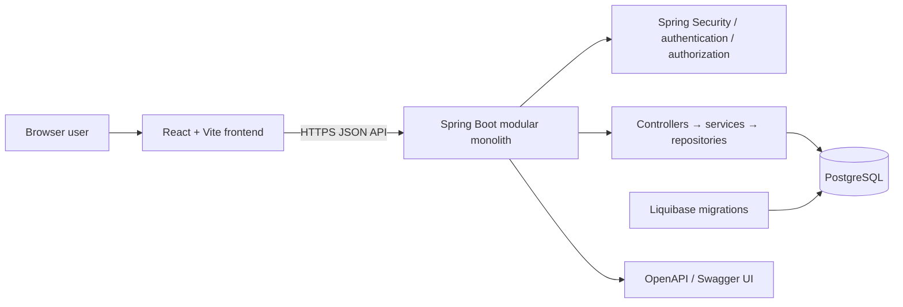

# System Architecture

**Status:** Current through Block 5. Deployment, later AE workflow stages, integrations, and several operational requirements remain open.

## Current shape

## Local implementation baseline

The frontend uses JavaScript, Vite, and Node.js 24 LTS. The backend build now targets Java 21 and Spring Boot 3.5.16 with Maven; Prosperr's prescribed versions, if any, take precedence. These are local compatibility choices, not confirmed company standards. Spring Boot 3.5.16 supports Java 17 and later, including Java 21. See the [Spring Boot system requirements](https://docs.spring.io/spring-boot/3.5/system-requirements.html).

## Boundaries

- `frontend/` owns presentation, navigation, client-side validation for usability, and API calls. It is not an authorization boundary.
- `backend/` owns authentication, authorization, validation, business rules, transactions, and persistence. Each API must enforce role and record-level access server-side.
- PostgreSQL is the durable source of business records. Liquibase is the controlled schema-change mechanism.
- The backend is one deployable modular monolith with clear internal modules. Module boundaries should follow confirmed business capabilities rather than speculative microservices.

## Implemented backend layers

`controller → service → repository → database`, with request/response DTOs, domain entities kept internal, centralized exception mapping, Jakarta Validation, and transaction boundaries in services.

## Authentication and authorization

Block 2 uses BCrypt and 15-minute signed JWT access tokens. The API returns the token at login; React keeps it in memory, with no refresh token. The JWT filter loads the current user on each request so deactivated accounts lose access immediately. One role is assigned per account. The first admin is seeded from environment configuration; admin-issued temporary passwords must be changed at next login. Backend endpoint authorization remains authoritative.

Block 5 gives every Sales Manager organization-wide access to BDR SQL review, opportunities, and BDR/AE performance. Approved SQLs may be assigned to any active AE; optional `manager_id` links are admin metadata and do not limit visibility. AE endpoints only expose the AE's own active assignments. Notifications are stored and read by their recipient only.

## Implemented business capabilities

Organisation/contact records; BDR leads, calls and follow-ups; SQL qualification/review; organization-wide manager dashboard and AE assignment; assignment history and in-app notifications; completed AE meeting logging and Won/Lost outcomes. Full opportunity stages, stakeholder management, L1/L2/L3 workflows, implementation handover, revival, targets, and leadership reporting remain for later blocks.

## Operational decisions still open

Java/Spring Boot and Node/package-manager versions; PostgreSQL hosting/version; Liquibase bootstrap strategy; development and production environments; CORS/origins; secrets management; logging/audit; backup/restore; observability; and deployment platform. No environment-specific values or secrets are committed.

## Architecture principles

- Keep transport, business logic, and persistence responsibilities separate.
- Use explicit DTO contracts; never serialize JPA entities directly.
- Treat server-side authorization and input validation as mandatory.
- Add indexes and pagination based on query patterns, not guesses.
- Document changes and database migrations alongside each feature.
- See the Block 2.5 [architecture review](ARCHITECTURE-DECISIONS.md), [design principles](DESIGN-PRINCIPLES.md), [pattern matrix](DESIGN-PATTERNS.md), and [quality standards](CODE-QUALITY-STANDARDS.md) before starting the next module.
